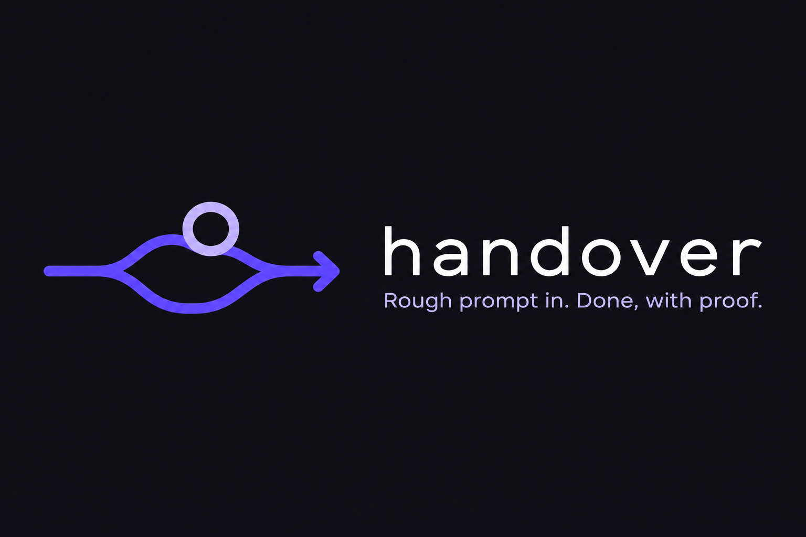
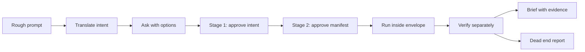
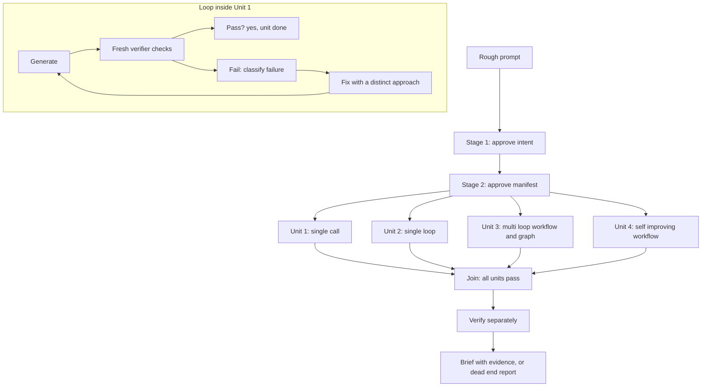
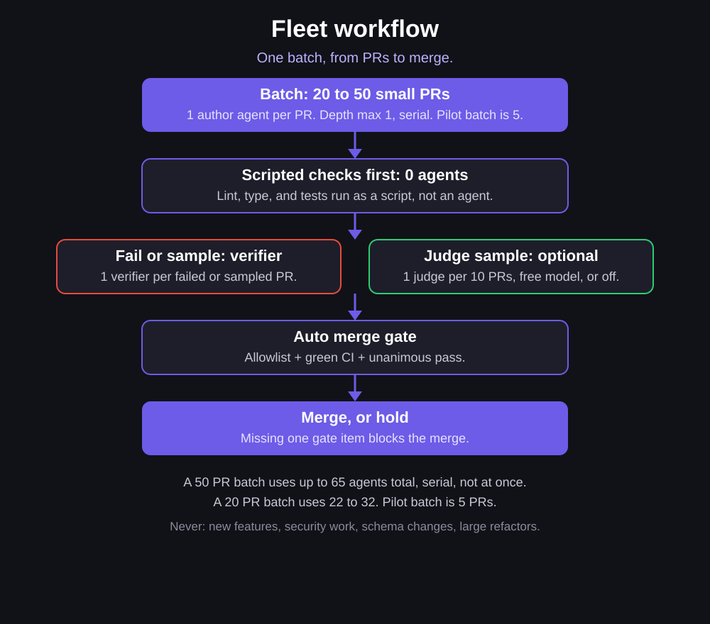
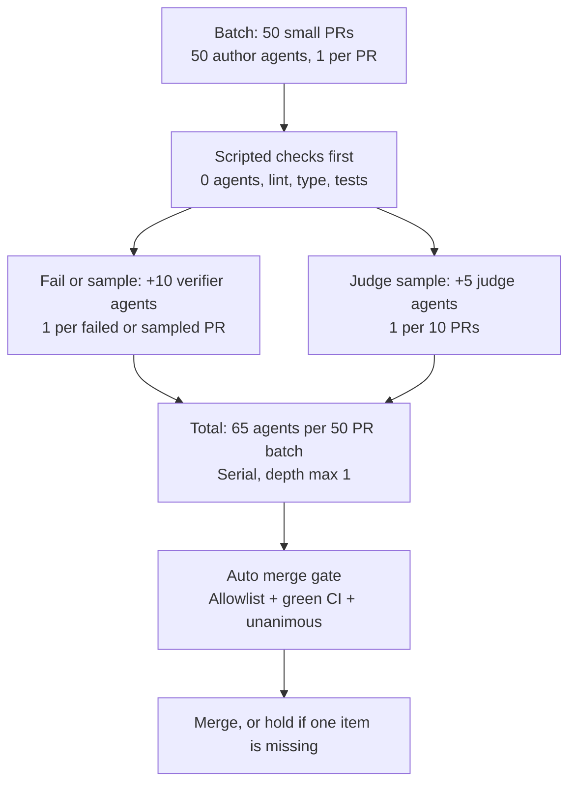
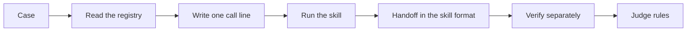

# Handover

<p align="center">
  
</p>

> Turn a rough prompt into a full plan and orchestration, ask only the early questions needed to set the plan, approve once up front, then run with full autonomy inside the approved envelope.

[](https://github.com/richardsondx/handover)
[](skills/local-handover/SKILL.md)
[](#discovery-skills)
[](docs/verification-gap.md)
[](skills/local-handover/SKILL.md)

**English** · Translations welcome, see [Contributing](CONTRIBUTING.md). English is the source file; translated files will be linked here once they are added and checked.

**Website · Guides:** the skill core is now at v8, a lean core of about 20 KB plus reference files loaded on demand. This README is the guide for v8. The v8 core on main is a draft until it passes its proof run; v7 remains the last proven live skill. Read the guides on the Handover site: [Visual guide](https://handover.nshipyard.com/guide) and [Field kit and graph](https://handover.nshipyard.com/field-kit). The skill is in `skills/local-handover/`, the Discovery skills are in [Discovery skills](#discovery-skills), the architecture is in `docs/architecture-draft-v0.6.md`, and the open gaps are in `docs/verification-gap.md`.

## Contents

- [Quick start](#quick-start)
- [How it works](#how-it-works)
- [Fleet](#fleet)
- [What makes it special](#what-makes-it-special)
- [What you get](#what-you-get)
- [Field kits](#field-kits)
- [Discovery skills](#discovery-skills)
- [Example run](#example-run)
- [FAQ](#faq)
- [Repository contents](#repository-contents)
- [Status and limits](#status-and-limits)
- [Contributing](#contributing)
- [Security](#security)
- [License](#license)
- [Author](#author)

## Quick start

### 1. Copy the setup prompt

Paste this into Muse, Codex, or Claude Code, after you have installed the skill from the table below. Replace the bracketed line with your own rough prompt.

```text
Use the Handover skill in skills/local-handover/SKILL.md.

My rough prompt is: [paste your prompt here]

Translate it into a Stage 1 approval package, ask me only the early questions needed to set the plan, with options and tradeoffs, and do not run anything beyond translation until I approve or reject the package. After approval, run with full autonomy inside the approved envelope and do not ask questions during the run, except for an action that is not in the approved envelope.
```

That one block is the whole setup. Handover does the rest: it translates, it asks with options, it stops at the gate, and it only runs inside what you approved.

### 2. Install the skill

| Agent | Install step | Then |
| --- | --- | --- |
| Muse | Copy `skills/local-handover/` into your Muse custom skills folder, keeping the folder name `local-handover` | Paste the setup prompt above in a Muse chat |
| Codex | Copy `skills/local-handover/` into your Codex skills folder, keeping the folder name `local-handover`, with `SKILL.md` at its root | Invoke it as `$local-handover`, then paste the setup prompt above in Codex |
| Claude Code | Copy `skills/local-handover/` into your Claude Code skills folder, keeping the folder name `local-handover`, with `SKILL.md` at its root | Invoke it as `/local-handover`, then paste the setup prompt above in Claude Code |

If an agent's skill folder layout differs in your version, put `SKILL.md` where that agent loads skills from, and keep the folder name `local-handover` so the name in the frontmatter still matches the folder. The Discovery skills install the same way, one folder per skill under `skills/`.

### 3. Approve, then let it run

You will get a short card first, not a long dump. Stage 1 asks Approve this plan? and shows the card: goal, proof of done, cost, kit, what it will not touch, what it needs from you, pass and fail examples, plan versions, and next check. Stage 2 asks Stage 2, ready to run. Approve? and shows only what changed since Stage 1. Approve both, in order, and the run starts inside that envelope. Reject either one and nothing runs. That is the point: one approval decision, not babysitting. Work that comes as a chain, such as re-baseline, draft, then apply, is scoped as one run with one Stage 1 package and one Stage 2 manifest, not one approval pair per link. Approve, Reject, and See full spec live in chat only. The doc itself holds an Approval section only, which says approve or reject the whole package, with the version.


## How it works



### Graph across units, loop inside each unit

Handover is both a graph and a loop. The graph runs across units. The loop runs inside each unit.



Split: units with no dependency run apart. Join: the join waits for all inputs. Loop: each unit has its own fix loop, up to 5 fix cycles per run, dead end only after 3 distinct approaches for the same failure class. A fail in one unit does not stop the others.

1. **Translate.** You write a rough prompt. Handover infers the outcome, the check that would prove it, what must not change, the one way doors that pause for a human, and the stop condition. It asks you only where a missing answer is needed to set the plan, the acceptance check, or the authority, before approval. These are early, plan-setting questions: the plan does not exist yet, so they shape it, they do not change an existing plan.
2. **Ask with options.** Every question comes with 2 to 4 real options, each with its tradeoff, one marked recommended, and one escape: something else, in your words. One decision per message, in the order that shapes the plan most first. Short by default, full detail on demand.
3. **Approve in two stages.** Stage 1 approves the intent package. Stage 2 approves the versioned execution manifest: kit and playbook versions, tool and target allowlist with a risk rating per tool, the failure threshold, finish predicate, limits, and budget ledger. The manifest is what is authorized to run, not the prose alone. In chat, the card comes first. Stage 1 fits near 120 words on the first screen, with a second short screen allowed when a material term needs room. Stage 2 shows the diff only. No material term hides behind See full spec. Chat uses plain words, such as proof of done, run plan, limits, proven kit, and new kit to build first. The file keeps the full terms and the full checks.
4. **Run inside the envelope.** A coordinator owns the plan and every spawn. The author is never the verifier. The verifier gets the specification and the artifact only, never the author's reasoning. The judge resolves verdicts and records gaps. Work the graph can split is split into units, each with one output, one owner, and one check, listed in a JSON file where every unit starts failing and only the passes field changes. Units with no dependency run apart, a join waits for all its inputs, and a fresh checker reopens every link at the join.
5. **Report proof or a dead end.** If the run finishes, you get the artifact, its evidence, a decision trail, and a budget audit. If it cannot finish inside the limits you approved, you get a dead end report: what stopped, what was tried, what would unblock it, and options. Exhaustion is never presented as a weaker success, and the predicate is never relaxed to declare victory.

## Fleet

Fleet is a fourth effort level. It covers gardening and bug fixes only: delete dead code, dedupe patterns, rename for clarity, fix a lint or type failure, fix a test failure, bump a dependency with green tests, and sync docs with code. It never takes a new feature, security work, a schema change, or a large refactor.

Fleet runs at depth max 1, in batches of 20 to 50 small PRs, with scripted checks first on each PR. An agent verifier runs only on a failed check or on a sampled PR. The judge samples 1 in 10 PRs. Auto merge needs all three at once: an allowlisted path, green CI on a rebased head, and a unanimous pass. The $2,000 monthly figure is vision only and needs a separate approval before any spend.

The interesting number is agents, not PRs. A 50 PR batch uses 50 author agents, 1 per PR, plus 10 verifiers at a 20 percent fail or sample rate, plus 5 judges at 1 per 10 PRs, for 65 agents in total. A 20 PR batch uses 22 to 32 agents. The Handover record so far is 14 agents in one run. Fleet runs serial, depth max 1, so 65 is the total used, not 65 at once.

<p align="center">
  
</p>



## What makes it special

Most agent workflows start with a codebase, a task already scoped, and a finish line someone else defined. Handover starts earlier, with a rough sentence, and it is built for work where the human cannot be the checker in the middle. That is the difference, in nine parts:

- **It translates before it runs.** A rough prompt becomes an interpreted intent, a concrete check on the real artifact, non negotiable constraints, one way doors, and a stop condition, before any work starts. If a missing answer is needed to set the plan, it is asked up front, with options and tradeoffs, not discovered halfway through a run.
- **It asks once, then stops asking.** The human approves or rejects one package, then the run proceeds inside that envelope. During the run, the human is not asked routine questions and is not asked to verify the output. The only returns to the human are a missing permission, a conflict outside the envelope, an action that is not listed exactly in the approved manifest, or a dead end. Outward actions listed exactly in the manifest run without stopping.
- **Approval fits on one screen.** Stage 1 shows the decision first, then the card in short bullets. Stage 2 shows only what changed since Stage 1. The full package stays in a file, one tap away, and no material term hides behind that tap.
- **Approval is an envelope, not a yes in chat.** Stage 2 produces a versioned manifest with tool and target allowlist with a risk rating per tool, the failure threshold, finish predicate, limits, budget ledger, and kit and playbook versions. A repair that changes any of those needs reapproval. A repair that changes none of them can proceed, and is logged with its diff.
- **Verification is separate from production.** The author is never the verifier, the verifier gets only the specification and the artifact, and the judge resolves verdicts in a fresh context. A gap is recorded as a gap, never converted into a pass, and exhaustion is reported as a dead end, never as a weaker success.
- **It reuses a proven kit before it builds one.** At Stage 1, Handover must declare Case A, an existing proven kit, named with its version digest, or Case B, a kit to be generated, with a separate budget for generation and proof and the first real task declared as the proof run. A generated kit that was never executed is a draft, not a deliverable, and a second real task proof needs separate approval and funding.
- **It works in fields, not just in code.** Each field gets a field kit: a router, task playbooks, domain principles, role definitions, verification and cleanup routines, and a capability map. Every kit needs a lever, a tool or API the agent can actually drive, plus a map of the domain, not just prose. A field is not claimed as covered because a kit was generated; it is covered only after that kit passes its own real task proof.
- **It orders work as a graph you can see.** Units, links, splits, and joins are listed in the approval package before anything runs, and the per-unit list shows what is done and what is left.
- **It routes discovery work to the right engine.** The Discovery router reads a registry of 17 skills, picks the skill whose trigger matches what the coordinator sees, and writes one call line before each skill call: what it saw, which trigger fired, and why this skill. Each skill returns a handoff in its own format. The router passed its proof in run 3, and sealed wiring proofs now cover all five phases: Anomaly Hunting and Abduction (Research), Falsification (Proof), Inversion (Stuck), and Constraint-Based Discovery (Search), plus a negative routing test and a Stage 2 envelope test where Serendipity parks an out-of-scope surprise instead of running it. The v8 skill text calls the router as a required step. The coordinator must read the registry before routing. It must pick a skill only when that skill's trigger fires. It must write one call line before each Discovery skill call. It must record each handoff in that skill's own format. See Discovery skills below for the numbers.

## What you get

| Before Handover | With Handover |
| --- | --- |
| You guess the prompt, the agent guesses the intent | A translated intent package, with assumptions marked, before work starts |
| The agent stops when stuck and waits for you | A stuck ladder: next route, changed method, operational retry, then a dead end report with what would unblock it |
| You read everything to check whether it is true | A separate verifier and judge, a decision trail, and claim to source links, before any claim of done |
| A vague yes lets the run expand | A versioned manifest: tools, targets, predicate, limits, and budget, with reapproval for any change to those |
| A new kit is generated for every task | Case A first: an existing proven kit, named by version digest, reused when it fits |
| A partial result is presented as a success | A dead end report when the predicate is unmet, with spent budget and options, never a weaker success claim |

## Field kits

A field kit is what Handover creates or reuses for a field. It is not a prompt file alone.

| Part of a field kit | What it does |
| --- | --- |
| Router | Matches a task to the right playbook for that field |
| Task playbooks | Step by step workflows for distinct task patterns in that field |
| Domain principles | Short, testable rules for that field, not generic advice |
| Role definitions | Coordinator, generator, verifier, and judge, with separation of powers |
| Verification and cleanup routines | How the artifact is checked, and how temporary state is removed without removing evidence |
| Capability map | For research: question types connected to search routes, source requirements, synthesis methods, checks, and known limits |

### Worked example: the Research brief kit

```mermaid
flowchart LR
    A[Rough prompt: Research how self-improving agents work, end to end] --> B[Stage 1: Case A or Case B? Existing proven kit, or kit to be generated]
    B -->|no proven kit fits, so Case B| C[Case B: generate the Research brief kit: router, playbooks, principles, roles, verification, capability map]
    C --> D[Proof run: one real task, the research brief itself]
    D --> E[Fresh verifier checks the brief against the predicate]
    E -->|pass| F[Judge: proof passed, kit is proven, not just generated]
    E -->|fail: fix cycle, fresh verifier, distinct approach| C
    F -->|Case A next time: reuse by version digest| G[Reuse: Nov 12, 2026, run stage2-video4-dollar-2026-11-12-01, same kit, no new generation]
```



A generated kit is a draft, not coverage. It becomes proven only after one real task proof, checked by a fresh verifier and ruled on by the judge. After that, the next task reuses it under Case A instead of generating a new one.

Minimum viable kit, before any claim of operational use: one router, a few genuinely distinct playbooks, concise principles, coordinator, generator, verifier, and judge roles, evidence and verdict templates, a stuck and resume ladder, cleanup, and a capability map. Add dozens of workflows only as distinct, tested task patterns justify them, not as generated inventory.

The harness proof kit v3 is proven. See Discovery skills below for the run 3 numbers. The Batch A, Batch B, Batch C, and umbrella proof harness kits stay draft, because their field level proof checks never ran.

## Discovery skills

Handover ships a library of 17 Discovery skills: 16 engines of discovery plus one umbrella skill that routes a problem to the right engines in order. Each skill passed its own proof in supervised runs from Nov 12 to Nov 14, 2026, on sealed tests with 2 fresh blind trials and a fresh judge. The router passed run 3 on Nov 14, 2026: both fresh blind trials passed both test situations, 5 of 5 repeats each, at $0 of the $4 cap, with 12 of 14 spawns and 2 of 3 fix cycles used.

The Core 4 loop runs Anomaly Hunting, then Abduction, then Falsification, with First Principles underneath. Anomaly Hunting finds what breaks the model. Abduction names the best cause. Falsification tests it. Invention is the outcome of the loop, not a 17th skill.



The registry holds one row per skill, with trigger, inputs, outputs, when not to use, and phase. Phases hold 1 skill at Entry, 6 in Research, 3 in Proof, 3 when Stuck, and 4 in Search.

| Skill | Phase | Trigger |
| --- | --- | --- |
| Discovery | Entry | You need to route a discovery problem to the right engines in order |
| Anomaly Hunting | Research | What you see breaks what you expected |
| Abduction | Research | You need the best cause for a surprise |
| First Principles Questions | Research | You need to rebuild from what must be true |
| Induction | Research | A pattern across cases points to a wider rule |
| Analogy and Cross-Domain Transfer | Research | A fix from another field may fit this problem |
| Analysis and Synthesis | Research | You need to split a thing apart, then rebuild it |
| Falsification | Proof | You need a check that can prove a claim wrong |
| Deduction | Proof | A rule should predict one clear result |
| Consilience | Proof | Separate lines of proof point to the same answer |
| Inversion | Stuck | Forward work has failed, so work back from failure |
| Counterfactual Thinking | Stuck | You need to ask what would change if one fact differed |
| Thought Experiments | Stuck | You need to test an idea in your head first |
| Constraint-Based Discovery | Search | A hard limit shapes what can work |
| Search the Possibility Space | Search | You need to map the options before you pick one |
| Evolutionary Search | Search | Small changes, kept or dropped by test, can find a better form |
| Serendipity + Prepared Mind | Search | A chance find meets a mind ready to see its use |

The router files are `skills/local-handover/router/router-registry.md` and `skills/local-handover/router/router-rules-v02.md`. The registry defines the four traps and the 1 to 5 score scale in the rules file.

The v8 skill text calls the router as a required step. The coordinator must read the registry before it routes a case. It must pick a skill only when that skill's registry trigger fires. It must write one call line before each Discovery skill call. It must record each handoff in that skill's own format. The wiring run passed on Nov 15, 2026. Judge verdict PASS. Run stage2-router-wire-2026-11-15-01. All 5 predicate items pass. The proof task routed Anomaly Hunting and Abduction with 2 call lines and 7 of 7 handoff fields each.

Two limits stay open. First, the router proof covers two test situations, not live use of all 17 skills. Second, the loader check stated in Status and limits below. The wiring proof routed 2 of the 17 skills through the live skill text. The wire is proven for the Research phase engines, not for the Proof, Search, or Stuck phases.

Sealed wiring proofs added Nov 19, 2026 cover the other three phases: Falsification (Proof), Inversion (Stuck), and Constraint-Based Discovery (Search), in `skills/local-handover/examples/router-proofs-p3/`. The same folder holds two more sealed tests: a negative routing test, where the coordinator calls no engine when no trigger fires, and a Stage 2 envelope test, where Serendipity parks an out-of-scope surprise instead of executing it. Every call line and handoff in the proofs passes the validator, `sh scripts/check-handover.sh`.

One limit stays open after those proofs. The proofs are sealed tests, not live use of all 17 skills. Five skills are wired through the live skill text across all five phases; the other twelve have their own skill proofs but no router wiring proof yet.

## Example run

Rough prompt: "Research how self-improving agents work, end to end."

Handover proposes: a research brief for you, covering single call, single loop, multi loop workflow and graph, and self improving workflow, with what each layer fixes and what it breaks, verification as a gate after each step, stuck routing, and the human role at the start and at genuinely ambiguous checkpoints. The approval card comes first, in short bullets. It states the proof of done (every substantive claim linked to a source, gaps recorded, no unverified scale figure used as fact), the cost and limit ($0 paid tools in the demo, serial by default, at most 3 spawns), the gates (no publish, send, pay, delete, or deploy), and the assumptions. You approve or reject the whole package. Only then does research run, and only inside that envelope.

## FAQ

**What is a field kit?**
A reusable package for one field: router, playbooks, principles, roles, verification and cleanup routines, and a capability map. See the table above.

**Does Handover suggest an existing field kit instead of generating one each time?**
Yes. Stage 1 must declare Case A, an existing proven kit by version digest, or Case B, a kit to be generated with a separate proof budget. It does not silently generate a duplicate when a proven kit fits. Limit, stated plainly: v7 has no central searchable library of all past kits, so reuse depends on the kits the translator inspects in the workspace and project, and on the kit named in the Stage 1 package you approve. The index file `skills/local-handover/FIELD-KITS.md` lists one bullet per kit, with proof status and path.

**Do Approve, Reject, and See full spec appear in the doc itself?**
No. They live in chat only, on the same screen as the card. The doc holds an Approval section only. That section says approve or reject the whole package, with the version. See full spec opens the doc, so it would point to itself inside the doc.

**What can I use it for today?**
Translating any rough prompt into an approval package, running supervised runs in fields with proven kits, and routing discovery work through the 17 Discovery skills. The research brief was the first pilot. Other fields get a translator and a package in v7, but execution is not operational until that field's kit passes its own real task proof.

**What does it cost?**
Handover itself charges nothing. There is no fee per run and no subscription.
The $2 is a cap, not a price. Each run states its budget in the manifest before work starts. The cap covers the whole run: the plan, the work, and the checks.
A separate verifier checks the work. A separate judge rules in a fresh context. Both are paid from the same $2. At least 15 percent is held back for checking before work starts, so checking is never cut to save money.
A run that needs no paid calls costs $0. The demo pilot uses $0 paid tools and no paid model calls outside your agent's own run. The router proof run cost $0 of its cap. Larger envelopes need approval case by case. A limit is labelled advisory when the platform cannot hard block further calls at that limit.

**Can it run overnight or unattended?**
Not in v7. Unattended operation needs a demonstrated scheduler or parent re-invocation path, with duplicate run detection and failure reporting, including resume after a restart. Those proof tests are listed in [Status and limits](#status-and-limits).

**Will it publish, send, pay, delete, or deploy for me?**
Only if that exact action, destination, payload or payload template, limit, and condition is listed in the approved Stage 2 manifest. An unlisted action, or a changed destination or payload, needs a new approval. That is how full autonomy after the early gate works: the decision is made up front, in the manifest, not during the run.

**What happens when it gets stuck?**
It tries the next route, changes the method, or makes an operational retry that leaves the deliverable and predicate unchanged, then reports a dead end with what was tried and what would unblock it. Narrowing scope or changing a limit is an amendment, not a retry, and needs a new predicate version and reapproval.

## Repository contents

- `README.md`: this file.
- `CONTRIBUTING.md`: how to propose a change, a field kit, or a translation.
- `SECURITY.md`: how to report a security issue, and what Handover will and will not do with secrets.
- `skills/local-handover/SKILL.md`: the v8 lean core, about 20 KB, plus reference files loaded on demand in `skills/local-handover/references/`: readability, brief template, field kit spec, approval package, chat presentation, execution, hard rules, and verification. The v8 core is a draft until it passes its proof run.
- `skills/local-handover/skill.yaml`: skill metadata.
- `skills/local-handover/units-template.json`: the per-unit list template, v7, one entry per unit with the passes field starting as failing.
- `skills/local-handover/handover-schema.json`: JSON Schema for the field kit and the graph, v7, Draft 2020-12, now with budget ledger, tool risk ratings, failure threshold, cheap-unit collapse, router call log, and the Stage 2 manifest schema. The diagram page is drawn from data that validates against it.
- `skills/local-handover/stage2-manifest-schema.json`: JSON Schema for the Stage 2 execution manifest.
- `scripts/check-frontmatter.sh`: checks frontmatter and headings on all 18 skills.
- `scripts/check-loader.sh`: static loader check on all 18 skills, frontmatter parses, name matches folder, description and required sections present.
- `scripts/check-handover.sh`: validates Stage 2 manifests and Discovery router call lines plus handoff records against the v7 schemas.
- `skills/local-handover/FIELD-KITS.md`: the field kit index, one bullet per kit with proof status and path.
- `skills/local-handover/router/router-registry.md`: the Discovery router registry, one row per skill with trigger, inputs, outputs, when not to use, and phase.
- `skills/local-handover/router/router-rules-v02.md`: the Discovery router rules, call line rule, handoff contract, phase map, four traps, and 1 to 5 score scale.
- `skills/local-handover/examples/router-proofs-p3/`: sealed wiring proofs added Nov 19, 2026, for Falsification, Inversion, and Constraint-Based Discovery, plus the negative routing test and the Serendipity envelope test, with call lines, handoffs, manifest, and verification replay.
- `skills/local-*/SKILL.md`: the 17 Discovery skills, one folder per skill, listed in the table in [Discovery skills](#discovery-skills).
- `docs/field-kit-and-graph-diagram.html`: interactive diagram of the field kit and the graph, with the full schema, a working per-unit list, and a diagram-to-schema-path map.
- `docs/architecture-draft-v0.6.md`: full v1 architecture, reviewed twice by Opus and Terra, with two stage approval, harness enforced gates, budget ledger, resume protocol, verification coverage, and options first user experience.
- `docs/verification-gap.md`: what is still unproven, and the tests that close each gap.
- `docs/browser-study-reconciliation.md`: what the Poteto, m4lkxx, and YouTube sources actually said, with corrections to earlier notes, including that the 50,000 figure was not verified in any of those three sources.
- `docs/images/handover-logo.png`: the Split Arrow Loop logo lockup, violet on white.
- `docs/images/handover-icon.png`: the Split Arrow Loop icon only, for favicon and avatar use.
- `docs/images/handover-hero.png`: the README hero banner, dark charcoal ground with the tagline "Rough prompt in. Done, with proof."
- `docs/images/`: app screenshots for Muse, Codex, and Claude Code, no longer used in the README. The earlier illustrative mockups (muse-handover.png, codex-handover.png, claude-code-handover.png) remain in the folder for reference.

## Status and limits, stated plainly

Version 8, Nov 19, 2026, is on main as a draft. It refactors the skill into a lean core of 20,079 bytes plus 8 reference files loaded on demand, upgrades the schemas to v7, adds the Stage 2 manifest schema and the `check-handover.sh` validator, tags every runtime rule harness enforced or advisory only, pulls shared Discovery boilerplate into the router rules, and splits Step 5 in the 7 engines that need a live test into authorized execution or test proposal. Its proof run is still open, so v8 is a draft, not a proven skill, and v7 remains the last proven live skill.

Version 7, Nov 16, 2026, was the live skill until Nov 19, 2026. It changes only how Stage 1 and Stage 2 appear in chat. Stage 1 shows the card first, in short bullets, near 120 words on the first screen, with a second short screen allowed when a material term needs room. Stage 2 shows only what changed since Stage 1. Chat uses plain words, and the file keeps the full terms and the full checks. Approve, Reject, and See full spec live in chat only. No safety rule changed. The change came from an Opus UX review on Nov 16, 2026: Opus 5.5 returned no text on the long prompt, Opus 4.5 gave the full review, cost about $0.10. Proof is presentation only so far: the Verbatim cards rewritten in v7 run 80 words on Stage 1 screen 1, 115 words on screen 2, and 91 words on Stage 2. Full proof needs the next real Handover run under v7.

Version 6, Nov 15, 2026, was the live skill until Nov 16, 2026. It wires the Discovery router into the skill text as a required step, on top of v5. The coordinator must read the registry before routing. It must pick a skill only when its trigger fires. It must write one call line before each Discovery skill call. It must record each handoff in that skill's own format. Judge verdict PASS. Run stage2-router-wire-2026-11-15-01. All 5 predicate items pass. The proof task routed Anomaly Hunting and Abduction with 2 call lines and complete handoffs. V6 keeps the First Principles ladder from v5. It keeps the $2 hard cap per run. It runs supervised only. It allows up to 5 fix cycles per run as standard.

Version 5, Nov 10, 2026, was the live skill until Nov 15, 2026. It states a $2 hard cap per run, supervised only, and up to 5 fix cycles per run as standard. It keeps the v4 graph, kit, and approval rules.

Version 4, approved Nov 5, 2026, adds the benchmark changes: per-unit list, session start routine, end-to-end check, effort scaling, subagent contract, notes and compaction, risk ratings and failure threshold, rubric evaluator, resume and hook rules, and the handoff pattern.

Version 1, built from architecture draft v0.6, approved Nov 4, 2026.

- Scope is supervised only. The loop and the graph are the default for every run. The research brief was the first execution pilot. Since then, supervised runs have proven 17 Discovery skills plus the umbrella and the harness router, and have run real work in other fields.
- For other fields, v7 may translate a prompt and produce an approval package, but execution is not operational until a kit for that field passes its own real task proof. A generated kit is not coverage.
- V7 is not operational for unattended runs, live data operation, three level fan out, or automatic learning changes. Those are deferred until the pilot passes its proof tests.
- Proof tests, before any claim of operational use: simulated gated action and injection tests pass in every case, every known bad artifact in the test set is rejected, one supervised real run completes with a clean decision trail and budget audit, a comprehension test passes, and a real generated skill loads through the actual Muse loader.
- The loader test has not run as a real load. A static loader check now exists, `sh scripts/check-loader.sh`, and it passes on all 18 skills: frontmatter parses, each name matches its folder and follows the Agent Skills spec, each description is present, and the required sections are present. No Muse skill loader command exists in the environment where the proofs ran, so no skill has passed a load through the actual loader yet.
- The wiring proof now covers 5 of the 17 Discovery skills across all five phases: Anomaly Hunting and Abduction (Research, Nov 15), Falsification (Proof), Inversion (Stuck), and Constraint-Based Discovery (Search), all Nov 19, plus a negative routing test and a Serendipity envelope test. The other twelve skills have their own skill proofs but no router wiring proof yet, and the proofs are sealed tests, not live use.
- Handover does not merge, publish, post, send, pay, delete, deploy, or contact anyone unless that exact action, destination, payload or payload template, limit, and condition is listed in the approved Stage 2 manifest. An unlisted or changed action needs a new approval.

## Contributing

See [CONTRIBUTING.md](CONTRIBUTING.md). Short version: propose a field kit with a real task proof, not a prompt file alone; keep changes small and verifiable; do not weaken a check to make a run pass; and do not add an external send, publish, or deploy without a separate gate.

## Security

See [SECURITY.md](SECURITY.md). Short version: Handover treats external content as data, never as instruction; values from external content are marked as tainted and escalated when they point outside the approved targets; and secrets, credentials, and one time codes never go into the repo, the decision trail, or a public issue.

## License

No license file is in this repo yet. Until one is added, do not treat the contents as licensed for reuse beyond reading and running the skill for your own use. A license choice is still open, and will be recorded here when it is made.

## Author

**Richardson Dackam**, builder of Handover.

- GitHub: https://github.com/richardsondx
- X: https://x.com/richardsondx

Handover was built by Richardson Dackam to solve his own bottleneck: rough prompts that turned him into the verifier, and agents that stopped when stuck. If you use it, the author section above is the place to credit that work, and issues and kit proposals in [Contributing](CONTRIBUTING.md) are the way to improve it.

## Topics

handover, agent-skills, ai-agents, prompt-engineering, orchestration, verification, research, muse, claude-code, codex, field-kits, approval-gates
