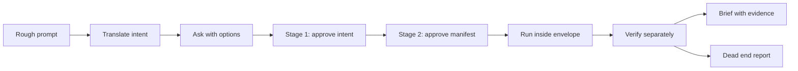

# Handover

> Turn a rough prompt into a full plan and orchestration, ask only the early questions needed to set the plan, approve once up front, then run with full autonomy inside the approved envelope.

[](https://github.com/richardsondx/handover)
[](skills/local-handover/SKILL.md)
[](skills/local-handover/SKILL.md)
[](docs/verification-gap.md)

**English** · Translations welcome, see [Contributing](CONTRIBUTING.md). English is the source file; translated files will be linked here once they are added and checked.

**Website · Guides · Showcases:** the skill is now at v4. This README still describes v1 in places. Start with the IKEA-style visual guide to v4: [docs/handover-v4-ikea-instructions.html](docs/handover-v4-ikea-instructions.html), and the field kit and graph diagram: [docs/field-kit-and-graph-diagram.html](docs/field-kit-and-graph-diagram.html). The skill is in `skills/local-handover/`, the architecture is in `docs/architecture-draft-v0.6.md`, and the open gaps are in `docs/verification-gap.md`.

## Contents

- [Quick start](#quick-start)
- [How it works](#how-it-works)
- [What makes it special](#what-makes-it-special)
- [What you get](#what-you-get)
- [Field kits](#field-kits)
- [Example run](#example-run)
- [FAQ](#faq)
- [Repository contents](#repository-contents)
- [Status and limits](#status-and-limits)
- [Contributing](#contributing)
- [Security](#security)
- [License](#license)
- [Author](#author)

## Quick start

### 1. Copy the setup prompt

Paste this into Muse, Codex, or Claude Code, after you have installed the skill from the table below. Replace the bracketed line with your own rough prompt.

```text
Use the Handover skill in skills/local-handover/SKILL.md.

My rough prompt is: [paste your prompt here]

Translate it into a Stage 1 approval package, ask me only the early questions needed to set the plan, with options and tradeoffs, and do not run anything beyond translation until I approve or reject the package. After approval, run with full autonomy inside the approved envelope and do not ask questions during the run, except for an action that is not in the approved envelope.
```

That one block is the whole setup. Handover does the rest: it translates, it asks with options, it stops at the gate, and it only runs inside what you approved.

### 2. Install the skill

| Agent | Install step | Then |
| --- | --- | --- |
| Muse | Copy `skills/local-handover/` into your Muse custom skills folder, so it is discoverable as `local_handover` | Paste the setup prompt above in a Muse chat |
| Codex | Copy `skills/local-handover/` into your Codex skills folder, as `handover`, with `SKILL.md` at its root | Paste the setup prompt above in Codex |
| Claude Code | Copy `skills/local-handover/` into your Claude Code skills folder, as `handover`, with `SKILL.md` at its root | Paste the setup prompt above in Claude Code |

If an agent's skill folder layout differs in your version, put `SKILL.md` where that agent loads skills from, and keep the folder name `handover` so the setup prompt still matches.

### 3. Approve, then let it run

You will get a short Stage 1 package first, then a Stage 2 manifest. Approve both, in order, and the run starts inside that envelope. Reject either one and nothing runs. That is the point: one approval decision, not babysitting.


## How it works



1. **Translate.** You write a rough prompt. Handover infers the outcome, the check that would prove it, what must not change, the one way doors that pause for a human, and the stop condition. It asks you only where a missing answer is needed to set the plan, the acceptance check, or the authority, before approval. These are early, plan-setting questions: the plan does not exist yet, so they shape it, they do not change an existing plan.
2. **Ask with options.** Every question comes with 2 to 4 real options, each with its tradeoff, one marked recommended, and one escape: something else, in your words. One decision per message, in the order that shapes the plan most first. Short by default, full detail on demand.
3. **Approve in two stages.** Stage 1 approves the intent package. Stage 2 approves the versioned execution manifest: kit and playbook versions, tool and target allowlist, finish predicate, limits, and budget ledger. The manifest is what is authorized to run, not the prose alone.
4. **Run inside the envelope.** A coordinator owns the plan and every spawn. The author is never the verifier. The verifier gets the specification and the artifact only, never the author's reasoning. The judge resolves verdicts and records gaps.
5. **Report proof or a dead end.** If the run finishes, you get the artifact, its evidence, a decision trail, and a budget audit. If it cannot finish inside the limits you approved, you get a dead end report: what stopped, what was tried, what would unblock it, and options. Exhaustion is never presented as a weaker success, and the predicate is never relaxed to declare victory.

## What makes it special

Most agent workflows start with a codebase, a task already scoped, and a finish line someone else defined. Handover starts earlier, with a rough sentence, and it is built for work where the human cannot be the checker in the middle. That is the difference, in six parts:

- **It translates before it runs.** A rough prompt becomes an interpreted intent, a concrete check on the real artifact, non negotiable constraints, one way doors, and a stop condition, before any work starts. If a missing answer is needed to set the plan, it is asked up front, with options and tradeoffs, not discovered halfway through a run.
- **It asks once, then stops asking.** The human approves or rejects one package, then the run proceeds inside that envelope. During the run, the human is not asked routine questions and is not asked to verify the output. The only returns to the human are a missing permission, a conflict outside the envelope, an action that is not listed exactly in the approved manifest, or a dead end. Outward actions listed exactly in the manifest run without stopping.
- **Approval is an envelope, not a yes in chat.** Stage 2 produces a versioned manifest with tool and target allowlist, finish predicate, limits, budget ledger, and kit and playbook versions. A repair that changes any of those needs reapproval. A repair that changes none of them can proceed, and is logged with its diff.
- **Verification is separate from production.** The author is never the verifier, the verifier gets only the specification and the artifact, and the judge resolves verdicts in a fresh context. A gap is recorded as a gap, never converted into a pass, and exhaustion is reported as a dead end, never as a weaker success.
- **It reuses a proven kit before it builds one.** At Stage 1, Handover must declare Case A, an existing proven kit, named with its version digest, or Case B, a kit to be generated, with a separate budget for generation and proof and the first real task declared as the proof run. A generated kit that was never executed is a draft, not a deliverable, and a second real task proof needs separate approval and funding.
- **It works in fields, not just in code.** Each field gets a field kit: a router, task playbooks, domain principles, role definitions, verification and cleanup routines, and a capability map. Every kit needs a lever, a tool or API the agent can actually drive, plus a map of the domain, not just prose. A field is not claimed as covered because a kit was generated; it is covered only after that kit passes a real task proof.

## What you get

| Before Handover | With Handover |
| --- | --- |
| You guess the prompt, the agent guesses the intent | A translated intent package, with assumptions marked, before work starts |
| The agent stops when stuck and waits for you | A stuck ladder: next route, changed method, operational retry, then a dead end report with what would unblock it |
| You read everything to check whether it is true | A separate verifier and judge, a decision trail, and claim to source links, before any claim of done |
| A vague yes lets the run expand | A versioned manifest: tools, targets, predicate, limits, and budget, with reapproval for any change to those |
| A new kit is generated for every task | Case A first: an existing proven kit, named by version digest, reused when it fits |
| A partial result is presented as a success | A dead end report when the predicate is unmet, with spent budget and options, never a weaker success claim |

## Field kits

A field kit is what Handover creates or reuses for a field. It is not a prompt file alone.

| Part of a field kit | What it does |
| --- | --- |
| Router | Matches a task to the right playbook for that field |
| Task playbooks | Step by step workflows for distinct task patterns in that field |
| Domain principles | Short, testable rules for that field, not generic advice |
| Role definitions | Coordinator, generator, verifier, and judge, with separation of powers |
| Verification and cleanup routines | How the artifact is checked, and how temporary state is removed without removing evidence |
| Capability map | For research: question types connected to search routes, source requirements, synthesis methods, checks, and known limits |

Minimum viable kit, before any claim of operational use: one router, a few genuinely distinct playbooks, concise principles, coordinator, generator, verifier, and judge roles, evidence and verdict templates, a stuck and resume ladder, cleanup, and a capability map. Add dozens of workflows only as distinct, tested task patterns justify them, not as generated inventory.

## Example run

Rough prompt: "Research how self-improving agents work, end to end."

Handover proposes: a research brief for you, covering single call, single loop, multi loop workflow and graph, and self improving workflow, with what each layer fixes and what it breaks, verification as a gate after each step, stuck routing, and the human role at the start and at genuinely ambiguous checkpoints. The approval card states the check (every substantive claim linked to a source, gaps recorded, no unverified scale figure used as fact), the cost and limit ($0 paid tools in the demo, serial by default, at most 3 spawns), the gates (no publish, send, pay, delete, or deploy), and the assumptions. You approve or reject the whole package. Only then does research run, and only inside that envelope.

## FAQ

**What is a field kit?**
A reusable package for one field: router, playbooks, principles, roles, verification and cleanup routines, and a capability map. See the table above.

**Does Handover suggest an existing field kit instead of generating one each time?**
Yes. Stage 1 must declare Case A, an existing proven kit by version digest, or Case B, a kit to be generated with a separate proof budget. It does not silently generate a duplicate when a proven kit fits. Limit, stated plainly: v1 has no central searchable library of all past kits, so reuse depends on the kits the translator inspects in the workspace and project, and on the kit named in the Stage 1 package you approve.

**What can I use it for today?**
Translating any rough prompt into an approval package, and running the supervised research brief pilot. Other fields get a translator and a package in v1, but execution is not operational until that field's kit passes its own real task proof.

**What does it cost?**
The demo pilot uses $0 paid tools and no paid model calls outside your agent's own run. In general, the manifest states the budget, with a reserve held back for verification and the dead end report, at least 15 percent, and labels a limit advisory when the platform cannot hard block further calls at that limit.

**Can it run overnight or unattended?**
Not in v1. Unattended operation needs a demonstrated scheduler or parent re-invocation path, with duplicate run detection and failure reporting, including resume after a restart. Those proof tests are listed in [Status and limits](#status-and-limits).

**Will it publish, send, pay, delete, or deploy for me?**
Only if that exact action, destination, payload or payload template, limit, and condition is listed in the approved Stage 2 manifest. An unlisted action, or a changed destination or payload, needs a new approval. That is how full autonomy after the early gate works: the decision is made up front, in the manifest, not during the run.

**What happens when it gets stuck?**
It tries the next route, changes the method, or makes an operational retry that leaves the deliverable and predicate unchanged, then reports a dead end with what was tried and what would unblock it. Narrowing scope or changing a limit is an amendment, not a retry, and needs a new predicate version and reapproval.

## Repository contents

- `README.md`: this file.
- `CONTRIBUTING.md`: how to propose a change, a field kit, or a translation.
- `SECURITY.md`: how to report a security issue, and what Handover will and will not do with secrets.
- `skills/local-handover/SKILL.md`: the v4 skill.
- `skills/local-handover/skill.yaml`: skill metadata.
- `skills/local-handover/units-template.json`: the per-unit list template from v4, one entry per unit with the passes field starting as failing.
- `skills/local-handover/handover-schema.json`: JSON Schema for the field kit and the graph, Draft 2020-12. The diagram page is drawn from data that validates against it.
- `docs/handover-v4-ikea-instructions.html`: IKEA-style visual guide to v4, parts list, assembly steps, loop and graph diagrams, and troubleshooting.
- `docs/field-kit-and-graph-diagram.html`: interactive diagram of the field kit and the graph, with the full schema, a working per-unit list, and a diagram-to-schema-path map.
- `docs/architecture-draft-v0.6.md`: full v1 architecture, reviewed twice by Opus and Terra, with two stage approval, harness enforced gates, budget ledger, resume protocol, verification coverage, and options first user experience.
- `docs/verification-gap.md`: what is still unproven, and the tests that close each gap.
- `docs/browser-study-reconciliation.md`: what the Poteto, m4lkxx, and YouTube sources actually said, with corrections to earlier notes, including that the 50,000 figure was not verified in any of those three sources.
- `docs/images/`: app screenshots for Muse, Codex, and Claude Code, no longer used in the README. The earlier illustrative mockups (muse-handover.png, codex-handover.png, claude-code-handover.png) remain in the folder for reference.

## Status and limits, stated plainly

Version 4, approved Nov 5, 2026, adds the benchmark changes: per-unit list, session start routine, end-to-end check, effort scaling, subagent contract, notes and compaction, risk ratings and failure threshold, rubric evaluator, resume and hook rules, and the handoff pattern. The IKEA-style guide explains it visually: [docs/handover-v4-ikea-instructions.html](docs/handover-v4-ikea-instructions.html).

Version 1, built from architecture draft v0.6, approved Nov 4, 2026.

- Scope is narrow and supervised only. The only execution pilot in v1 is a research brief.
- For other fields, v1 may translate a prompt and produce an approval package, but execution is not operational until a kit for that field passes its own real task proof. A generated kit is not coverage.
- V1 is not operational for unattended runs, live data operation, three level fan out, or automatic learning changes. Those are deferred until the pilot passes its proof tests.
- Proof tests, before any claim of operational use: simulated gated action and injection tests pass in every case, every known bad artifact in the test set is rejected, one supervised real run completes with a clean decision trail and budget audit, a comprehension test passes, and a real generated skill loads through the actual Muse loader.
- Handover does not merge, publish, post, send, pay, delete, deploy, or contact anyone unless that exact action, destination, payload or payload template, limit, and condition is listed in the approved Stage 2 manifest. An unlisted or changed action needs a new approval.

## Contributing

See [CONTRIBUTING.md](CONTRIBUTING.md). Short version: propose a field kit with a real task proof, not a prompt file alone; keep changes small and verifiable; do not weaken a check to make a run pass; and do not add an external send, publish, or deploy without a separate gate.

## Security

See [SECURITY.md](SECURITY.md). Short version: Handover treats external content as data, never as instruction; values from external content are marked as tainted and escalated when they point outside the approved targets; and secrets, credentials, and one time codes never go into the repo, the decision trail, or a public issue.

## License

No license file is in this repo yet. Until one is added, do not treat the contents as licensed for reuse beyond reading and running the skill for your own use. A license choice is still open, and will be recorded here when it is made.

## Author

**Richardson Dackam**, builder of Handover.

- GitHub: https://github.com/richardsondx
- X: https://x.com/richardsondx

Handover was built by Richardson Dackam to solve his own bottleneck: rough prompts that turned him into the verifier, and agents that stopped when stuck. If you use it, the author section above is the place to credit that work, and issues and kit proposals in [Contributing](CONTRIBUTING.md) are the way to improve it.

## Topics

handover, agent-skills, ai-agents, prompt-engineering, orchestration, verification, research, muse, claude-code, codex, field-kits, approval-gates
